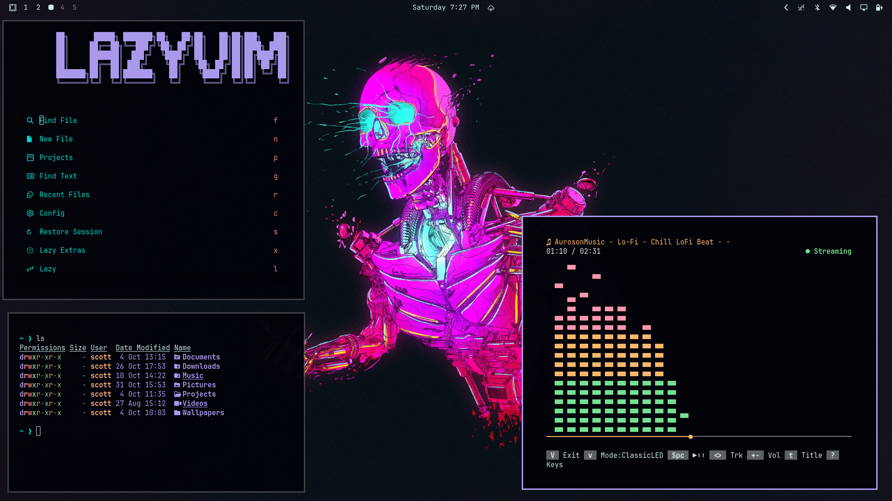

# Omarchy Cyberskull Theme

A dark Omarchy theme built around a violet accent (`#b09ff4`) on near-black, in the neon cyberpunk register of its wallpapers.



The palette was generated with [Aether](https://github.com/bjarneo/aether) for Omarchy v4.

## Installation

```sh
omarchy theme install https://github.com/smblasik/omarchy-cyberskull-theme
```

Then apply it:

```sh
omarchy theme set cyberskull
```

The install command derives the theme name from the repository name, so `omarchy-cyberskull-theme` installs as `cyberskull` automatically.

You can also install it from the Omarchy menu: _Install → Style → Theme_, then paste the repository URL.

## Palette

| Role | Color | | Role | Color |
|---|---|---|---|---|
| Accent | `#b09ff4` | | Magenta | `#ea84ee` |
| Background | `#010309` | | Bright magenta | `#ff99ff` |
| Foreground | `#d3eae9` | | Yellow | `#ffb687` |
| Muted | `#5f6368` | | Green | `#86ce9d` |
| Red | `#fd7d8e` | | Cyan | `#00ded0` |
| Blue | `#b09ff4` | | Orange | `#fd919f` |

Icon theme: `Yaru-magenta`. Mode: dark.

## Wallpapers

This theme ships with two backgrounds in `backgrounds/`. Cycle between them with:

```sh
omarchy theme bg next
```

| File | Source |
|---|---|
| `wallhaven-1p9vg9.jpg` | Cyberpunk cyborg closeup, uploaded by **pulsar2105** — 5120×2880 |
| `wallhaven-j5lk95.jpg` | Robot skull artwork by **Nick Sullo** — 2800×1400 |

To add your own, either drop images into `backgrounds/` in this repo, or into `~/.config/omarchy/backgrounds/cyberskull/` on your machine. Omarchy cycles both directories together.

## Credits

**Palette:** generated with [Aether](https://github.com/bjarneo/aether) (AUR: `yay -S aether`).

**`backgrounds/wallhaven-1p9vg9.jpg`:**
Uploaded to [Wallhaven](https://wallhaven.cc/w/1p9vg9) by **pulsar2105**. Tags include cyber, cyberpunk, synthwave, neon, cyborg. Wallhaven states that all images remain property of their original owners; copyright stays with the original artist.

**`backgrounds/wallhaven-j5lk95.jpg`:**
Robot skull artwork by **Nick Sullo**, posted to [Wallhaven](https://wallhaven.cc/w/j5lk95). The uploader did not provide an original source. Copyright remains with the artist.

**`preview.png`:** screenshot of this theme running on Omarchy.

Neither wallpaper is covered by this repository's MIT license — see [`LICENSE`](LICENSE). The MIT license applies only to the theme configuration files.
